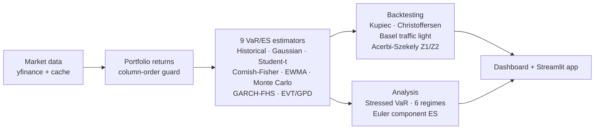

# VaR Engine Pro — Multi-Method Market Risk with Regulatory-Grade Backtesting

 


> **Live demo:** open [`dashboard/dashboard.html`](dashboard/dashboard.html) — a single self-contained interactive file (Plotly inlined, works offline). Move weights and confidence levels and watch VaR/ES recompute.
>
> **In one line:** nine VaR/ES estimators, a Basel-grade backtest suite, stressed VaR and Euler component ES — on 19 years of real data, cross-checked against Riskfolio-Lib.



A market-risk engine the way a bank's model-validation team would want to see
one built: **nine VaR/ES estimators** on 19 years of real data (2007–2026,
covering the GFC), a **backtest suite that follows the Basel framework**
(Kupiec, Christoffersen, conditional coverage, Acerbi–Székely ES diagnostics,
Basel traffic-light zones), **stressed VaR**, **regime analysis**, and
**Euler component ES** — packaged as an installable Python project with tests,
CI, a Streamlit app and an interactive Plotly dashboard.

> **Headline findings** (full sample 2007–2026, 99%): Gaussian ES is **1.91%**
> against Historical **2.95%** and EVT/GPD **2.97%** — the Gaussian tail is a
> third too thin, and its backtest is a massacre (108 exceptions vs 47
> expected). The estimator that actually earns trust is **GARCH filtered
> historical simulation**: 44 exceptions vs 42.4 expected, Kupiec p = 0.80,
> Basel **GREEN**, Acerbi–Székely Z2 = −0.09. Component ES says who owns the
> tail: SPY 58%, QQQ 33%, and TLT *negative* (−2.3%) — the bond sleeve is a
> hedge on this book's worst days, not a risk.

## Quickstart

```bash
make setup        # venv + requirements (arch, riskfolio-lib, quantstats, plotly, streamlit)
make run          # full pipeline -> results/ + dashboard/dashboard.html
make test         # pytest suite (19 tests)
make app          # Streamlit front-end (live weights / confidence level)
```

Or open `dashboard/dashboard.html` — a single self-contained interactive
file (Plotly inlined, works offline, no server).

## What's inside

| Layer | Contents |
|---|---|
| `src/var_engine/data.py` | Yahoo Finance download + cache; column-order guard (see below); fixed-weight portfolio returns |
| `src/var_engine/methods.py` | Historical, Gaussian, Student-t, Cornish–Fisher, EWMA/RiskMetrics, Monte Carlo (multiv normal & t), GARCH/EGARCH/GJR filtered historical simulation, EVT peaks-over-threshold (GPD) |
| `src/var_engine/backtest.py` | Kupiec POF, Christoffersen independence + conditional coverage, Basel traffic light, Acerbi–Székely Z1/Z2; rolling one-step-ahead backtests (GARCH refit annually on 750d) |
| `src/var_engine/analysis.py` | Six-regime table, stressed VaR (named windows + worst-vol 12m), component ES (Euler allocation, sums exactly to portfolio ES) |
| `src/var_engine/cli.py` | End-to-end pipeline; Riskfolio-Lib cross-check; QuantStats tearsheet |
| `src/var_engine/dashboard.py` | Plotly dashboard export |
| `app/streamlit_app.py` | Interactive app: move weights / confidence, VaR-ES recomputes live |
| `tests/` | 19 tests on synthetic data with known properties (a test must be able to fail for the right reason) |
| `RESEARCH.md` | The regulatory + academic basis (Basel MAR32, FRTB, Acerbi–Székely 2014, McNeil & Frey, Barone-Adesi) and deliberate omissions |
| `notebooks/` | Guided analysis incl. the EVT threshold sensitivity check |

## Cross-verification (not just self-consistency)

Historical VaR/CVaR from this engine is checked against **Riskfolio-Lib's
independent implementation** (`RiskFunctions.VaR_Hist` / `CVaR_Hist`) on every
pipeline run; the maximum disagreement is written to `results/summary.json`
and printed on the dashboard. Two codebases agreeing is stronger evidence
than one codebase run twice.

## The data trap this repo guards against

`yfinance` returns price columns **alphabetically**, not in request order.
Attach weights in that order and SPY's 35% silently lands on GLD.
`data.ensure_order()` reindexes immediately after download and is unit-tested
with shuffled columns — this bug was caught in verification of this project's
v1, and the test exists so it can never come back.

## Findings summary (2007–2026, 4,900+ trading days)

See `results/` for the full tables and the dashboard for the story:
method comparison at 95 / 97.5 / 99, backtest verdicts at 95 and 99,
ES by regime (the GFC regime's ES is a different animal from the AI-bull
regime's), stressed VaR at 2–3× the fair-weather figure, and component ES
showing which positions actually own the tail.

## Limitations (stated, not buried)

Daily-rebalanced fixed weights; no transaction costs in risk numbers.
GARCH backtest freezes parameters between annual refits. Monte Carlo tail
dependence is symmetric by construction (elliptical). EVT results are
threshold-sensitive (notebook quantifies it). ES backtests are diagnostics,
not verdicts — ES is not elicitable on its own, which is why Basel backtests
VaR and why this engine follows that split. Not a regulatory capital tool.

## Tooling (all free / open source)

bashtage/arch (GARCH) · dcajasn/Riskfolio-Lib (independent cross-check) ·
ranaroussi/quantstats (tearsheet) · plotly · streamlit · scipy · yfinance.
Data: Yahoo Finance. First draft built with AI assistance (disclosed);
research, verification and conclusions by the author. Not investment advice.

MIT License.
